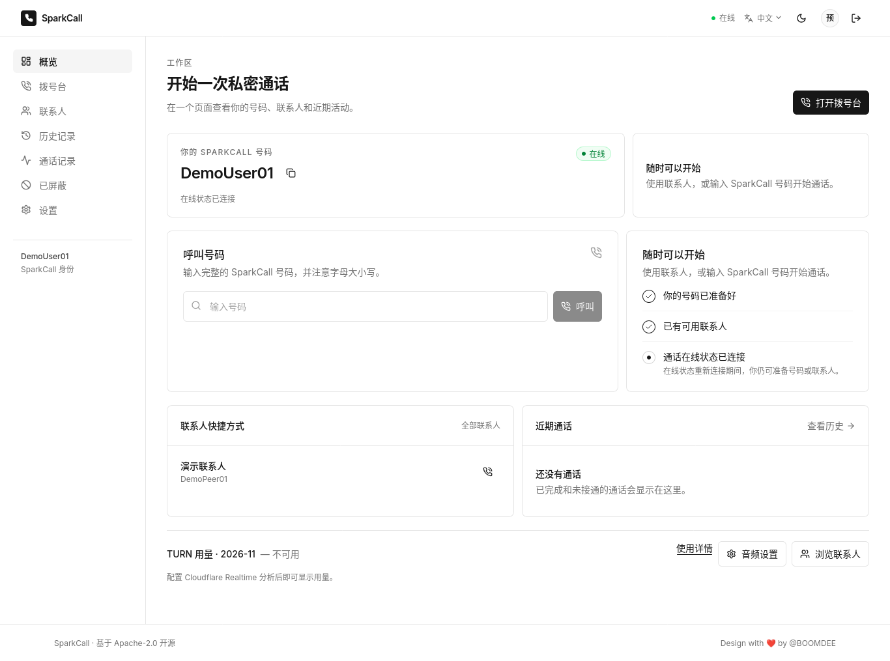
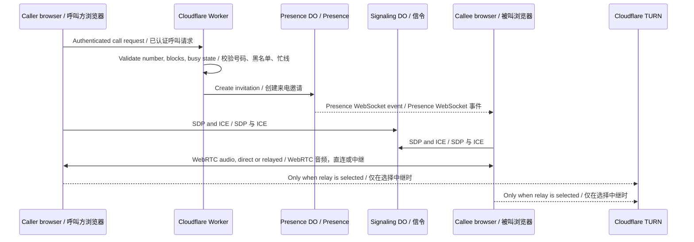

# SparkCall / 星火通话

[](LICENSE) [](CHANGELOG.md) [](.github/workflows/test.yml)

> **Version 0.1.0 · Early development / 早期开发**
>
> SparkCall is a browser-native audio-calling application built with React, WebRTC, Cloudflare Workers, D1, Durable Objects, and optional Cloudflare Realtime TURN relay. It is an early-stage, self-hostable codebase with a deployed public preview.
>
> SparkCall 是一个基于 React、WebRTC、Cloudflare Workers、D1、Durable Objects 和可选 Cloudflare Realtime TURN 中继的浏览器原生语音通话应用。它是可自行部署的早期代码库，现已上线公开预览。
>
> **Release status / 发布状态:** Pre-release public preview: [call.boomdee.dpdns.org](https://call.boomdee.dpdns.org). The deployed Worker passed 19 rollout smoke checks covering HTTPS/assets, authentication, short-lived TURN credential issuance, D1 preferences, Presence/Signaling WebSockets, and server-side call cancellation. Real two-device audio and cross-NAT media connectivity have not yet been accepted.
>
> **当前状态:** 预发布公开预览：[call.boomdee.dpdns.org](https://call.boomdee.dpdns.org)。已部署 Worker 通过 19 项上线冒烟检查，覆盖 HTTPS/静态资源、认证、短期 TURN 凭据签发、D1 偏好、Presence/Signaling WebSocket 和服务端通话取消。尚未完成双设备真实音频及跨 NAT 媒体连通验收。

## Contents / 目录

- [Overview and status / 项目概览与状态](#overview-and-status--项目概览与状态)
- [Implemented features / 已实现功能](#implemented-features--已实现功能)
- [Dashboard preview / 工作台预览](#dashboard-preview--工作台预览)
- [Architecture / 架构](#architecture--架构)
- [Repository tree / 实际仓库目录](#repository-tree--实际仓库目录)
- [Prerequisites and quick start / 前置条件与快速开始](#prerequisites-and-quick-start--前置条件与快速开始)
- [Environment and Worker secrets / 环境变量与 Worker Secret](#environment-and-worker-secrets--环境变量与-worker-secret)
- [D1 migrations / D1 迁移](#d1-migrations--d1-迁移)
- [WebRTC, TURN, and Force TURN / WebRTC、TURN 与 Force TURN](#webrtc-turn-and-force-turn--webrtcturn-与-force-turn)
- [Incoming-call webhook / 来电 Webhook](#incoming-call-webhook--来电-webhook)
- [Privacy and security posture / 隐私与安全姿态](#privacy-and-security-posture--隐私与安全姿态)
- [Testing / 测试](#testing--测试)
- [CI, deployment, and rollback / CI、部署与回滚](#ci-deployment-and-rollback--ci部署与回滚)
- [Known limitations / 已知限制](#known-limitations--已知限制)
- [Contributing / 贡献](#contributing--贡献)
- [Security reporting / 安全报告](#security-reporting--安全报告)
- [Code of Conduct / 行为准则](#code-of-conduct--行为准则)
- [License and author / 许可证与作者](#license-and-author--许可证与作者)

## Overview and status / 项目概览与状态

SparkCall explores a privacy-conscious, self-hostable calling workflow: create an account or temporary identity, receive a SparkCall number, manage contacts and blocks, place browser audio calls, and optionally publish selected call records. The Worker authorizes API and WebSocket entry points; Durable Objects coordinate signaling and presence; WebRTC carries audio directly between browsers or through TURN when direct connectivity is unavailable. The application does not record audio.

SparkCall 探索一种注重隐私、可自行部署的通话流程：创建账号或临时身份、获得 SparkCall 号码、管理联系人和黑名单、发起浏览器语音通话，并可选择公开特定通话记录。Worker 负责 API 和 WebSocket 入口授权；Durable Objects 协调信令与在线状态；WebRTC 在浏览器之间直传音频，无法直连时再使用 TURN。应用不会录制音频。

This repository is an early pre-release with a live public preview. There is no production SLA, certification, guaranteed call quality, strict billing enforcement, or complete browser/device coverage. Admin-configurable, estimate-based per-user TURN credential limits are implemented, but they are not a hard billing or spending cap. R2 uploads, payments/3DS, and recording are not implemented or enabled.

本仓库是早期预发布版本，已提供在线公开预览，但不承诺生产 SLA、安全认证、通话质量、严格账单强制执行或完整浏览器/设备覆盖。现已实现管理员可配置的按用户 TURN 凭证估算限额，但它不是硬性账单或消费上限。R2 上传、支付/3DS 和录音尚未实现或启用。

## Implemented features / 已实现功能

The following describes checked-in behavior, not a product roadmap. / 以下描述当前代码已实现的行为，而不是产品路线图。

| English | 简体中文 |
| --- | --- |
| Username/password registration, login, logout, session lookup, and temporary guest accounts with a 24-hour default lifetime. | 用户名/密码注册、登录、退出、会话查询，以及默认 24 小时有效的临时访客账号。 |
| Upgrade a temporary identity to a permanent account while retaining eligible identity, contacts, and records. | 将临时身份升级为永久账号，并保留符合条件的身份、联系人和记录。 |
| Case-insensitive usernames; case-sensitive SparkCall numbers with availability checks and reserved names. | 用户名不区分大小写；SparkCall 号码区分大小写，并支持可用性检查与保留名称。 |
| Dashboard and dialer accept either a SparkCall username or number; usernames resolve case-insensitively while exact-number calling remains supported. | 工作台和拨号台均可输入 SparkCall 用户名或号码；用户名按不区分大小写查找，原号码拨号继续可用。 |
| Browser WebRTC audio calls with incoming invitations, accept, reject, busy, cancel, hang up, timeout, failure, and short reconnect handling. | 浏览器 WebRTC 音频通话，支持来电、接听、拒绝、忙线、取消、挂断、超时、失败和短时重连。 |
| Authenticated WebSocket signaling for SDP offers/answers and ICE candidates, plus a separate presence object for invitations. | 经过认证的 WebSocket 信令用于 SDP offer/answer 和 ICE candidate；独立 presence 对象传递来电。 |
| Microphone mute, input-device selection, echo cancellation, noise suppression, automatic gain control, bitrate preferences, and supported output-device selection. | 麦克风静音、输入设备选择、回声消除、噪声抑制、自动增益、码率偏好，以及在浏览器支持时选择输出设备。 |
| Contacts with names, notes, favorites, lookup, update, delete, and blocked-number/user management. | 联系人名称、备注、收藏、查询、修改、删除，以及号码/用户黑名单管理。 |
| Call history and detail views with status, duration, and participant metadata. | 带状态、时长和参与者元数据的通话历史与详情页面。 |
| Private call records with title, description, notes, tags/metadata, editable slug, explicit public/revoked state, expiration, consent filtering, and temporary-owner capability recovery. | 默认私有的通话记录，支持标题、描述、备注、标签/元数据、可编辑 slug、显式公开/撤销、过期、同意过滤和临时所有者 capability 恢复。 |
| Public record pages at `/callrecords/:slug` omit internal identifiers and sensitive metadata and use `noindex, nofollow`. | `/callrecords/:slug` 公共记录页移除内部标识和敏感元数据，并设置 `noindex, nofollow`。 |
| Server-issued short-lived Cloudflare Realtime TURN credentials, sampled per-user/platform usage estimates, and admin-managed individual or bulk monthly TURN limits. A known estimate at or above the limit pauses new TURN credentials; missing or failed analytics is fail-open. Actual peer-to-peer traffic is not TURN usage. These are not exact billing caps. | 服务端签发短期 Cloudflare Realtime TURN 凭据，提供按用户/平台的采样用量估算，以及管理员设置的单用户或批量月度限额。只有已取得的估算达到上限时才暂停新的 TURN 凭据；采样或分析不可用时 fail-open。实际点对点流量不计为 TURN 用量。这不是精确账单上限。 |
| Responsive React UI with light/dark presentation, loading/empty/error states, keyboard-friendly forms, localization, and a 404 route. | 响应式 React 界面，包含浅色/深色呈现、加载/空/错误状态、键盘友好表单、本地化和 404 路由。 |

## Dashboard preview / 工作台预览

The screenshot below is the approved local preview. It contains synthetic account and contact data and does not indicate a live or production deployment.

以下是已批准的本地预览截图，使用合成账号和联系人数据，不表示在线或生产部署。



Captured locally after registering a synthetic preview account and adding a synthetic contact. No real credentials, personal account data, or call records are shown.

该图在本地注册合成预览账号并添加合成联系人后获取；未展示真实凭据、个人账号资料或通话记录。

## Architecture / 架构

### Request and media path / 请求与媒体路径



The browser uses same-origin REST and authenticated WebSockets. The Worker validates sessions, numbers, ownership, blocks, preferences, and call participation before calling a Durable Object. Durable Objects carry signaling/control data only; they do not carry or store audio. D1 stores application metadata. Worker Assets serve the SPA, and an hourly cron performs cleanup and best-effort TURN usage snapshots.

浏览器使用同源 REST 和经过认证的 WebSocket。Worker 在调用 Durable Object 前校验会话、号码、所有权、黑名单、偏好和通话参与者。Durable Objects 仅承载信令/控制数据，不承载或存储音频。D1 存储应用元数据。Worker Assets 提供 SPA；每小时 cron 执行清理和尽力而为的 TURN 用量快照。

See [architecture.md](docs/architecture.md) for the detailed security boundary and [cloudflare-references.md](docs/cloudflare-references.md) for official implementation references.

详细安全边界见 [architecture.md](docs/architecture.md)；Cloudflare 官方实现依据见 [cloudflare-references.md](docs/cloudflare-references.md)。

## Repository tree / 实际仓库目录

```text
.
├── apps/web/                         React 19 + TypeScript + Vite frontend / 前端
│   ├── src/App.tsx                   SPA routes / SPA 路由
│   ├── src/pages/                    landing, auth, dashboard, dialer, records / 页面
│   ├── src/contexts/                 call session and WebRTC lifecycle / 通话状态
│   ├── src/components/               shared UI / 共用 UI
│   ├── src/lib/                     API, formatting, WebRTC helpers and tests / 工具
│   └── src/i18n/                    English and Simplified Chinese locales / 本地化
├── workers/api/src/                  Cloudflare Worker / Worker API
│   ├── index.ts                      fetch, scheduled entry, DO exports / 入口
│   ├── api.ts                        authenticated REST routes / REST 路由
│   ├── auth.ts                       password, session, token and rate limiting / 认证
│   ├── calls.ts                      call creation and lifecycle / 通话生命周期
│   ├── signaling.ts                  signaling and presence Durable Objects / 信令
│   ├── turn.ts                       TURN credentials, analytics and snapshots / TURN
│   └── webhook.ts                    encrypted incoming-call webhook / 来电 Webhook
├── migrations/                       ordered D1 migrations / 有序 D1 迁移
│   ├── 0001_initial.sql
│   ├── 0002_security_and_preferences.sql
│   ├── 0003_preserve_record_capabilities.sql
│   ├── 0004_incoming_call_webhooks.sql
│   └── 0005_version_user_preferences.sql
├── scripts/test-integration.py       isolated local Wrangler/D1 HTTP test / 集成测试
├── docs/                             architecture, deployment, testing, references / 文档
├── .github/workflows/                test, preview artifact, manual deploy / 工作流
├── wrangler.jsonc                    Worker/Assets/D1/DO template with safe placeholders / 安全占位配置模板
├── package.json                      workspaces and root scripts / 工作区脚本
├── CONTRIBUTING.md                   contribution workflow / 贡献流程
├── CODE_OF_CONDUCT.md                community standards / 行为准则
├── SECURITY.md                       vulnerability reporting / 安全报告
└── LICENSE                           Apache License 2.0 / Apache 2.0 许可证
```

This tree lists existing project paths only; it does not imply unimplemented services, R2 storage, or a public deployment.

该目录树只列出实际存在的路径；不暗示未实现的服务、R2 存储或公开部署。

## Prerequisites and quick start / 前置条件与快速开始

### Prerequisites / 前置条件

- Node.js 22 or newer and npm.
- Python 3 for the isolated integration runner.
- A modern browser with microphone permission for manual audio checks.
- Cloudflare credentials are not needed for unit tests or local-only D1/API checks. TURN credentials enable relay fallback and `forceTurn`; in automatic mode the client still attempts direct ICE if credential retrieval fails, but cross-NAT connectivity is not guaranteed.

- Node.js 22 或更高版本，以及 npm。
- 集成测试运行器需要 Python 3。
- 真实音频人工检查需要支持麦克风权限的现代浏览器。
- 单元测试及仅本地 D1/API 检查无需 Cloudflare 凭据。TURN 凭据用于中继回退和 `forceTurn`；自动模式在凭据获取失败时仍会尝试直连 ICE，但不能保证跨 NAT 连通。

### Quick start with Wrangler / 使用 Wrangler 快速开始

```bash
npm ci
cp .dev.vars.example .dev.vars
# Generate high-entropy local values; never commit .dev.vars.
# 生成高熵本地值；不要提交 .dev.vars。
# Paste each output into the matching key in .dev.vars. / 将每条输出粘贴到 .dev.vars 对应的键。
openssl rand -hex 32      # INTERNAL_SIGNALING_TOKEN / 内部信令令牌
openssl rand -base64 32   # SPARKCALL_WEBHOOK_ENCRYPTION_KEY / Webhook AES-GCM key
CI=1 npm run db:migrate:local
npm run build
npm run dev:worker
```

Open `http://localhost:8787`. For Wrangler-only development, set `ALLOWED_ORIGIN=http://localhost:8787`.

打开 `http://localhost:8787`。仅使用 Wrangler 开发时，将 `ALLOWED_ORIGIN` 设置为 `http://localhost:8787`。

### Vite HMR / Vite 热更新

In a second terminal, run `npm run dev:web` and set `ALLOWED_ORIGIN=http://localhost:5173`. Vite serves the frontend at `http://localhost:5173` and proxies `/api` and WebSocket traffic to Wrangler at `127.0.0.1:8787`.

在第二个终端运行 `npm run dev:web`，并设置 `ALLOWED_ORIGIN=http://localhost:5173`。Vite 在 `http://localhost:5173` 提供前端，并将 `/api` 与 WebSocket 请求代理到 `127.0.0.1:8787`。

`.dev.vars` is Git-ignored. Keep secrets out of source, browser bundles, screenshots, and logs. The Worker bindings are `DB`, `SIGNALING`, `PRESENCE`, and `ASSETS`; the D1 database name used by scripts is `sparkcall-db`.

`.dev.vars` 已被 Git 忽略。请勿将 secret 放入源码、浏览器 bundle、截图或日志。Worker 绑定为 `DB`、`SIGNALING`、`PRESENCE` 和 `ASSETS`；脚本使用的 D1 数据库名称为 `sparkcall-db`。

The checked-in Wrangler config uses a placeholder D1 UUID and `app.example.com`; local development uses isolated local D1. For a remote deployment, supply your own D1 UUID and a hostname in a Cloudflare-managed zone. Do not commit account-specific replacements.

仓库中的 Wrangler 配置使用占位 D1 UUID 和 `app.example.com`；本地开发使用隔离的本地 D1。远程部署时请提供自己的 D1 UUID，以及由 Cloudflare 管理的域名；不要提交包含账号专属值的替换配置。

## Environment and Worker secrets / 环境变量与 Worker Secret

Use `.dev.vars.example` as the local template. The table names values and purposes only; use placeholders such as `<generated-secret>`, `<cloudflare-account-id>`, and `<turn-key-id>`, never real values.

使用 `.dev.vars.example` 作为本地模板。下表只说明名称和用途；请使用 `<generated-secret>`、`<cloudflare-account-id>`、`<turn-key-id>` 等占位符，不要填入真实值。

| Name / 名称 | Class / 类型 | Purpose / 用途 |
| --- | --- | --- |
| `INTERNAL_SIGNALING_TOKEN` | Worker secret | Cryptographically random token with at least 32 bytes of entropy for Worker↔Durable Object authentication. Required for calling/signaling. / Worker 与 Durable Object 内部认证所用的密码学随机 token，至少 32 字节熵；通话/信令必需。 |
| `TURN_KEY_ID` | Worker secret | Cloudflare Realtime TURN key identifier. / Cloudflare Realtime TURN key 标识。 |
| `TURN_API_TOKEN` | Worker secret | Server-only token used to request short-lived ICE credentials. / 仅服务端使用，用于请求短期 ICE 凭据。 |
| `SPARKCALL_WEBHOOK_ENCRYPTION_KEY` | Worker secret | Base64-encoded 32-byte AES-GCM key for encrypted webhook URL storage. / Base64 编码的 32 字节 AES-GCM 密钥，用于加密存储 Webhook URL。 |
| `TURN_ANALYTICS_API_TOKEN` | Optional Worker secret | Account Analytics Read token for sampled TURN egress analytics. / 用于采样 TURN egress 分析的 Account Analytics Read token。 |
| `CLOUDFLARE_ACCOUNT_ID` | Non-secret Worker variable / CI value | Selects the Cloudflare account for analytics and Wrangler. Use a placeholder in docs. / 指定 Cloudflare 账号；文档中只使用占位符。 |
| `TURN_MONTHLY_QUOTA_BYTES` | Non-secret display variable | Display-only reference quota; not a call gate, hard cap, or bill. / 仅用于显示的参考配额，不是通话闸门、硬上限或账单。 |
| `ALLOWED_ORIGIN` | Non-secret variable | Expected browser origin, for example a local placeholder origin. / 预期浏览器 Origin，例如本地占位 Origin。 |
| `SESSION_TTL_SECONDS` | Non-secret variable | Permanent-session lifetime; default example is `2592000`. / 永久会话时长；示例默认值为 `2592000`。 |
| `TEMP_SESSION_TTL_SECONDS` | Non-secret variable | Temporary-session lifetime; default example is `86400`. / 临时会话时长；示例默认值为 `86400`。 |
| `TURN_CREDENTIAL_TTL_SECONDS` | Non-secret variable | Requested lifetime for issued TURN credentials. / 已签发 TURN 凭据的请求有效期。 |
| `ADMIN_USER_IDS` | Non-secret variable | Optional comma-separated immutable SparkCall user IDs allowed to view platform totals and manage per-user TURN limits. / 可选的逗号分隔 SparkCall 内部用户 ID，用于查看平台总量和管理用户 TURN 限额。 |
| `D1_DATABASE_ID` | Deployment variable / 部署变量 | Target D1 database UUID; not a secret, but keep account-specific values out of Git. / 目标 D1 数据库 UUID；它不是 secret，但账号专属值不要提交到 Git。 |
| `SPARKCALL_HOSTNAME` | Deployment variable / 部署变量 | Custom hostname in the same Cloudflare account's active zone. / 当前 Cloudflare 账号活动 Zone 中的自定义域名。 |

`INTERNAL_SIGNALING_TOKEN`, TURN credentials, analytics tokens, and the webhook encryption key are Worker secrets configured directly on the Worker (or local `.dev.vars`). They must never be stored in Git, sent to the browser, bundled into frontend assets, or printed in logs. GitHub Actions deployment credentials are separate: `CLOUDFLARE_API_TOKEN` and `CLOUDFLARE_ACCOUNT_ID` are repository secrets used by the manual deployment workflow to authenticate Wrangler; they are not substitutes for the Worker secrets above.

`INTERNAL_SIGNALING_TOKEN`、TURN 凭据、分析 token 和 Webhook 加密密钥都是直接配置在 Worker（或本地 `.dev.vars`）中的 Worker secret。它们绝不能存入 Git、发送到浏览器、打包进前端资源或打印到日志。GitHub Actions 部署凭据是另一套凭据：`CLOUDFLARE_API_TOKEN` 与 `CLOUDFLARE_ACCOUNT_ID` 是手动部署工作流用于 Wrangler 认证的仓库 secret，不是上面 Worker secret 的替代品。

## D1 migrations / D1 迁移

Migrations are ordered SQL files under `migrations/` and must be applied incrementally. The current checked-in sequence is:

迁移是 `migrations/` 下的有序 SQL 文件，必须增量应用。当前仓库序列为：

| Migration / 迁移 | Scope / 范围 |
| --- | --- |
| `0001_initial.sql` | Users, sessions, contacts, blocks, call history, records, numbers, and usage snapshots. / 用户、会话、联系人、黑名单、通话历史、记录、号码和用量快照。 |
| `0002_security_and_preferences.sql` | Record capabilities, participant snapshots, number-change metadata, preferences, login-attempt counters, and reserved numbers. / 记录 capability、参与者快照、号码变更元数据、偏好、登录尝试计数和保留号码。 |
| `0003_preserve_record_capabilities.sql` | Keeps eligible record ownership/call metadata after temporary-user cleanup with `ON DELETE SET NULL`. / 临时用户清理后保留符合条件的记录能力和通话元数据，并使用 `ON DELETE SET NULL`。 |
| `0004_incoming_call_webhooks.sql` | Stores one encrypted incoming-call webhook configuration per user, with send timestamps. / 每个用户存储一份加密的来电 Webhook 配置及发送时间。 |
| `0005_version_user_preferences.sql` | Adds a monotonic version to preference snapshots for serialized, race-resistant updates. / 为偏好快照加入单调版本号，降低并发更新竞态。 |
| `0006_user_turn_quotas.sql` | Adds a nullable per-user monthly TURN egress limit. / 为用户增加可选的月度 TURN egress 限额。 |

Local migration and remote migration are distinct operations:

本地迁移和远程迁移是不同操作：

```bash
CI=1 npm run db:migrate:local
# Only an explicitly authorized release operator may run this remotely:
npx wrangler d1 migrations apply sparkcall-db --remote
```

Do not edit an already-applied migration. Add a new numbered migration, review compatibility, and back up the target database before a release. Never put a real database ID in README examples or source documentation.

不要修改已经应用的迁移。请新增编号迁移、审查兼容性，并在发布前备份目标数据库。README 示例和源代码文档中绝不放入真实数据库 ID。

## WebRTC, TURN, and Force TURN / WebRTC、TURN 与 Force TURN

By default, the browser obtains short-lived ICE server credentials from the Worker and creates `RTCPeerConnection` with `iceTransportPolicy: "all"`. WebRTC attempts a direct peer-to-peer path first; Cloudflare Realtime TURN is available as relay fallback when network conditions prevent direct connectivity. Audio remains encrypted by WebRTC and is not carried by the signaling Durable Objects.

默认情况下，浏览器从 Worker 获取短期 ICE server 凭据，并以 `iceTransportPolicy: "all"` 创建 `RTCPeerConnection`。WebRTC 优先尝试点对点直连；网络条件阻止直连时可使用 Cloudflare Realtime TURN 中继。音频仍由 WebRTC 加密，不经由信令 Durable Object 承载。

The audio setting `forceTurn` selects relay-only mode: the client uses `iceTransportPolicy: "relay"`. If TURN credentials cannot be loaded, a forced-relay call fails instead of silently falling back to direct connectivity. This is useful for controlled network/privacy testing, but it requires working server-side TURN configuration.

音频设置 `forceTurn` 会启用仅中继模式：客户端使用 `iceTransportPolicy: "relay"`。如果无法加载 TURN 凭据，强制中继通话会失败，而不会静默退回直连。这适合受控网络/隐私测试，但要求服务端 TURN 配置可用。

Cloudflare Realtime TURN and SFU share a monthly 1,000 GB free allowance; after that, egress is priced at $0.05 per GB. TURN billing counts traffic sent from Cloudflare to the TURN client, including TURN overhead after successful authentication; TURN and SFU do not have separate free allowances. Check the [official Realtime pricing](https://developers.cloudflare.com/realtime/sfu/platform/pricing/) and [TURN FAQ](https://developers.cloudflare.com/realtime/turn/faq/) for current terms. Workers and Durable Objects have separate pricing. The global `TURN_MONTHLY_QUOTA_BYTES` remains display-only; admins can assign per-user limits in Settings or bulk-apply one to all users. A known sampled estimate at or above a configured user limit pauses new TURN credentials; missing or failed analytics is fail-open. Peer-to-peer media does not use TURN and is not counted as TURN egress. Existing credentials remain valid until expiry. Analytics are sampled and time-windowed, marked `authoritative: false`; per-user admin snapshots rotate through at most 25 active accounts per hour, and temporary-account snapshots are removed when the account is cleaned up. Delays and outstanding credentials can cause overage, so this is a best-effort relay guard—not an exact bill, hard spending cap, or guaranteed billing limit. See [TURN analytics](https://developers.cloudflare.com/realtime/turn/analytics/).

Cloudflare Realtime TURN 和 SFU 共用每月 1,000 GB 免费额度；超过后按每 GB $0.05 的 egress 计费。TURN 账单统计 Cloudflare 发往 TURN 客户端的数据（包括成功认证后的 TURN 协议开销）；TURN 和 SFU 不各自拥有独立免费额度。请以 [官方 Realtime 定价](https://developers.cloudflare.com/realtime/sfu/platform/pricing/) 和 [TURN FAQ](https://developers.cloudflare.com/realtime/turn/faq/) 为准。Workers 与 Durable Objects 另行计费。全局 `TURN_MONTHLY_QUOTA_BYTES` 仍只用于展示；管理员可在设置中逐用户配置限额，也可批量应用到所有用户。只有已取得的采样估算达到限额时，Worker 才会暂停签发新的 TURN 凭据；采样或 Analytics 缺失/故障时 fail-open，继续签发。点对点媒体流量不经过 TURN，不计入 TURN egress。已有凭据会在过期前继续有效。数据标记为 `authoritative: false`；管理员列表每小时最多轮转采样 25 个活跃账号，临时账号清理时其快照会删除。采样延迟和未过期凭据可能造成超额，因此这只是尽力而为的中继闸门，不是准确账单、硬性消费上限或保证生效的计费限制。另见 [TURN 分析](https://developers.cloudflare.com/realtime/turn/analytics/)。

## Incoming-call webhook / 来电 Webhook

The optional incoming-call webhook is a best-effort HTTPS `GET` sent after an incoming invitation is created. The configured URL is stored encrypted with AES-GCM under migration `0004`; the encryption key is `SPARKCALL_WEBHOOK_ENCRYPTION_KEY` and stays server-side.

可选来电 Webhook 是在创建来电邀请后尽力发送的 HTTPS `GET`。配置的 URL 由迁移 `0004` 规定使用 AES-GCM 加密存储；加密密钥是 `SPARKCALL_WEBHOOK_ENCRYPTION_KEY`，只保留在服务端。

The request preserves the configured path/query and adds these query parameters:

请求保留配置的路径/查询参数，并添加以下查询参数：

| Parameter / 参数 | Meaning / 含义 |
| --- | --- |
| `event=incoming_call` | Event name / 事件名称。 |
| `call_id=<opaque-call-id>` | Application call identifier; treat it as sensitive metadata. / 应用通话标识，应视为敏感元数据。 |
| `timestamp=<iso-timestamp>` | Call creation timestamp. / 通话创建时间。 |

Only HTTPS URLs are accepted. Userinfo, fragments, localhost-like names, special/private IP literals, and private-looking DNS answers are rejected. DNS A/AAAA answers are checked immediately before sending; redirects are manual and the request has a short timeout, no-store cache behavior, and no response-body processing. Sends are rate-limited to at most one per user per 60 seconds and endpoint/response data is not logged.

只接受 HTTPS URL。带 userinfo、fragment、localhost 类名称、特殊/私有 IP 字面量或解析到私有地址的 DNS 会被拒绝。发送前会检查 DNS A/AAAA 结果；重定向采用 manual，且请求有短超时、no-store 缓存策略，不处理响应体。每个用户最多每 60 秒发送一次，并且不记录端点或响应数据。

Because the event, call reference, and timestamp are query parameters on a GET URL, the recipient service and intermediary proxies may record them in access logs. Treat the call reference as sensitive metadata, configure only an endpoint you trust, and review its logging/retention policy. SparkCall's no-log behavior cannot control the recipient's infrastructure.

由于事件类型、通话引用和时间戳作为 GET URL 查询参数发送，接收服务或中间代理可能将其写入访问日志。请将通话引用视为敏感元数据，只配置可信端点，并检查接收方的日志/保留策略。SparkCall 不记录这些数据，并不代表接收方基础设施也不会记录。

These controls reduce SSRF risk but are not a complete network security boundary. Cloudflare Workers cannot pin the DNS result to the eventual socket connection, so DNS resolution-to-connect is a TOCTOU limitation. DNS behavior can change after validation; do not treat this feature as permission for private/VPC egress. The webhook is best-effort and does not guarantee delivery, authentication of the recipient, or retry semantics.

这些控制措施可降低 SSRF 风险，但不是完整的网络安全边界。Cloudflare Workers 无法将 DNS 解析结果固定到最终 socket 连接，因此存在解析到连接之间的 TOCTOU 限制。验证后 DNS 行为仍可能改变；不要把此功能视为允许访问私有网络/VPC。Webhook 仅尽力发送，不保证送达、接收方身份认证或重试语义。

## Privacy and security posture / 隐私与安全姿态

SparkCall applies defensive controls, but this pre-release is not certified and should not be assumed production-grade. Review configuration, permissions, secrets, logs, and browser behavior before exposing an instance.

SparkCall 采用多项防御性控制，但此预发布版本未获得任何认证，不应假定为生产级安全。公开实例前请审查配置、权限、secret、日志和浏览器行为。

- Passwords use versioned PBKDF2-SHA-256 with 310,000 iterations; plaintext passwords are not stored. / 密码使用版本化 PBKDF2-SHA-256（310,000 轮），不保存明文。
- Sessions use hashed tokens and `HttpOnly; Secure; SameSite=Lax` cookies; state-changing requests check Origin/CSRF conditions. / 会话使用 token 哈希与 `HttpOnly; Secure; SameSite=Lax` Cookie；状态变更请求检查 Origin/CSRF 条件。
- Inputs are bounded and validated; D1 queries are parameterized; login attempts are atomically counted. / 输入有长度和格式限制并经校验；D1 查询使用参数化；登录尝试原子计数。
- Worker-to-DO requests require `INTERNAL_SIGNALING_TOKEN`; signaling checks identity, role, message type, size, and rate limits. / Worker 到 DO 的请求要求 `INTERNAL_SIGNALING_TOKEN`；信令检查身份、角色、消息类型、大小和限流。
- Records are private by default. Public records are explicit, revocable, expirable, consent-filtered, and `noindex, nofollow`. / 记录默认私有；公开记录必须显式开启，可撤销、可过期、按同意过滤，并设置 `noindex, nofollow`。
- Temporary record capabilities are stored as hashes and can outlive temporary-account cleanup; losing the capability cookie can make management unrecoverable. / 临时记录 capability 以哈希存储，可在临时账号清理后继续存在；丢失 capability Cookie 可能导致无法恢复管理。
- Free-form notes and metadata are not automatically scrubbed for personal data; review content before publishing. / 自由备注和元数据不会自动脱敏，公开前必须审阅内容。
- TURN and analytics secrets remain server-side; only short-lived ICE credentials reach the browser. / TURN 与分析 secret 只在服务端；浏览器只接收短期 ICE 凭据。

## Testing / 测试

From the repository root: / 在仓库根目录运行：

```bash
npm ci
npm run check
npm run lint
npm test
npm run build
npm run quality
CI=1 npm run db:migrate:local
npm run test:integration
```

`npm run quality` runs strict TypeScript checks, ESLint, Vitest, and the Vite production build. `npm run test:integration` requires a frontend build and Python 3, starts a temporary loopback Wrangler Worker, applies migrations to isolated local D1, makes real local HTTP requests, removes inherited Cloudflare credentials, and cleans up its temporary state.

`npm run quality` 执行严格 TypeScript 检查、ESLint、Vitest 和 Vite 生产构建。`npm run test:integration` 需要前端构建和 Python 3，启动临时回环 Wrangler Worker，将迁移应用到隔离本地 D1，发送真实本地 HTTP 请求，移除继承的 Cloudflare 凭据并清理临时状态。

The tests cover authentication, validation, ownership, contacts, blocklists, calls, versioned/concurrent preference updates, records, privacy/expiry, capability retention, audio-playback recovery, and local HTTP/D1/WebSocket behavior. They do not prove microphone access, real browser audio, cross-NAT connectivity, remote TURN, speaker routing, remote Durable Object lifecycle, remote migrations, billing accuracy, or production readiness.

测试覆盖认证、校验、所有权、联系人、黑名单、通话、版本化/并发偏好更新、记录、隐私/过期、capability 保留、音频播放恢复以及本地 HTTP/D1/WebSocket 行为。但不能证明麦克风访问、真实浏览器音频、跨 NAT 连通、远程 TURN、扬声器路由、远程 Durable Object 生命周期、远程迁移、账单准确性或生产可用性。

See [testing.md](docs/testing.md) for coverage, isolation, release preflight, and manual verification gaps.

覆盖范围、隔离机制、发布预检和人工验证缺口见 [testing.md](docs/testing.md)。

## CI, deployment, and rollback / CI、部署与回滚

- `test.yml` runs quality and isolated integration checks on `Main` pushes, pull requests, and manual dispatch. / `test.yml` 在 `Main` 推送、PR 和手动运行时执行质量与隔离集成检查。
- `preview.yml` builds the project for pull requests and uploads `apps/web/dist/` as a review artifact; it does not publish a site. / `preview.yml` 为 PR 构建项目并上传 `apps/web/dist/` 审阅 artifact；不会发布站点。
- `deploy.yml` is manual-only via `workflow_dispatch`, with `api-token` or interactive device authorization. It has no push trigger. / `deploy.yml` 仅支持 `workflow_dispatch` 手动运行，可选 `api-token` 或交互式设备授权；没有 push 触发器。

The manual deployment workflow expects the non-secret repository variables `D1_DATABASE_ID` and `SPARKCALL_HOSTNAME`; it injects them into the safe placeholders only in the temporary runner. / 手动部署工作流需要非敏感 repository variables `D1_DATABASE_ID` 和 `SPARKCALL_HOSTNAME`，只会在临时 runner 中注入安全占位值。

The public preview has been deployed once through authorized Wrangler OAuth after passing the quality/integration and Worker-secret gates. Automatic production deployment remains disabled. Future releases still require an authorized maintainer to review the target configuration and complete the gates. The manual order is:

公开预览已在通过质量/集成和 Worker secret 门禁后，通过获授权的 Wrangler OAuth 完成一次部署。生产自动部署仍然关闭。后续发布仍需授权维护者审查目标配置并通过门禁。手动顺序为：

```bash
npx wrangler d1 migrations apply sparkcall-db --remote
npx wrangler deploy
```

The workflow checks required Worker secret names without printing or transmitting secret values, then applies remote migrations and deploys. GitHub Actions `CLOUDFLARE_API_TOKEN`/`CLOUDFLARE_ACCOUNT_ID` authenticate Wrangler only; the Worker secrets must already be configured directly on the Worker.

工作流会在不打印或传输 secret 值的前提下检查必需 Worker secret 名称，然后应用远程迁移并部署。GitHub Actions 的 `CLOUDFLARE_API_TOKEN`/`CLOUDFLARE_ACCOUNT_ID` 仅用于 Wrangler 认证；Worker secret 必须预先直接配置在 Worker 上。

The workflow is an update path, not a first-install bootstrap. Before its first run, create the `sparkcall` Worker without a `workers.dev` address, route, or custom domain, and configure the required secrets directly on that unbound Worker. The workflow fails closed if the Worker or secret names are missing; it attaches the configured custom hostname only after its checks pass.

该工作流用于更新，不负责首次 bootstrap。首次运行前，先创建没有 `workers.dev` 地址、路由或自定义域名绑定的 `sparkcall` Worker，并直接在该未公开 Worker 上配置所需 secret。若 Worker 或必需 secret 名称缺失，工作流会 fail closed；只有通过检查后才会绑定配置的自定义域名。

Rollback caveat: a Worker version may be rolled back only when it is compatible with the already-applied D1 schema. Do not delete or reverse an applied migration. Pause further releases, verify schema/code compatibility, and prefer forward-compatible migrations; back up remote D1 before release. Durable Object class lifecycle uses declarative `exports` and must not be mixed with the legacy migrations array.

回滚注意事项：只有与已应用 D1 schema 兼容的 Worker 版本才可回滚。不要删除或反向撤销已应用迁移。应暂停后续发布、确认 schema/代码兼容性，并优先采用向后兼容迁移；发布前备份远程 D1。Durable Object 类生命周期使用声明式 `exports`，不得与旧式 migrations 数组混用。

See [deployment.md](docs/deployment.md) for the maintained procedure. It is an operational guide, not evidence that deployment has succeeded.

维护流程见 [deployment.md](docs/deployment.md)。该文档是操作指南，不是部署成功的证据。

## Known limitations / 已知限制

- Cross-device, cross-browser, mobile-network, NAT, reconnect, accessibility, and speaker-routing acceptance remains manual work. / 跨设备、跨浏览器、移动网络、NAT、重连、无障碍和扬声器路由验收仍需人工完成。
- Workers Web Crypto does not provide native Argon2id here; password hashing uses PBKDF2-SHA-256. / 当前 Workers Web Crypto 不提供原生 Argon2id，密码哈希使用 PBKDF2-SHA-256。
- TURN analytics is sampled/time-windowed and `authoritative: false`; it is not a live bill. / TURN 分析经过采样和时间窗口统计，并标记 `authoritative: false`，不是实时账单。
- R2 avatars/uploads, payments/3DS, audio recording, and automatic quota blocking are not enabled. The hosted service is a pre-release public preview, not an SLA-backed production service. / R2 头像/上传、支付/3DS、录音和自动配额阻断尚未启用；托管站点是预发布公开预览，而非具有 SLA 保障的生产服务。
- Webhook DNS checks have a documented DNS-to-connect TOCTOU limitation and are best-effort. / Webhook DNS 检查存在已说明的解析到连接 TOCTOU 限制，且仅尽力发送。

## Contributing / 贡献

Read [CONTRIBUTING.md](CONTRIBUTING.md), [CODE_OF_CONDUCT.md](CODE_OF_CONDUCT.md), [SECURITY.md](SECURITY.md), and [AGENTS.md](AGENTS.md) before contributing. Keep changes focused, do not rewrite unrelated work, and do not include credentials, tokens, personal data, production secrets, or generated build output. Run checks relevant to the change and describe migration impact, affected routes/bindings, tests, and remaining limitations in the pull request.

贡献前请阅读 [CONTRIBUTING.md](CONTRIBUTING.md)、[CODE_OF_CONDUCT.md](CODE_OF_CONDUCT.md)、[SECURITY.md](SECURITY.md) 和 [AGENTS.md](AGENTS.md)。保持改动聚焦，不要重写无关工作，也不要提交凭据、token、个人数据、生产 secret 或构建产物。运行与改动相关的检查，并在 PR 中说明迁移影响、受影响路由/绑定、测试和剩余限制。

Use English Conventional Commit subjects such as `feat: add contact search`, `fix: reject expired capability`, or `docs: clarify local D1 setup`. Use an accurate Git author identity; do not impersonate or invent a contributor.

请使用英文 Conventional Commit subject，例如 `feat: add contact search`、`fix: reject expired capability` 或 `docs: clarify local D1 setup`。使用真实准确的 Git author identity；不得冒充或捏造贡献者。

## Security reporting / 安全报告

SparkCall `0.1.0` is an early preproduction release with no guaranteed response time, remediation timeline, or SLA. Do not disclose vulnerabilities, credentials, personal data, recordings, call metadata, or exploit details in public issues, pull requests, discussions, or commits. Use GitHub private vulnerability reporting/security advisory when enabled, or ask publicly only for a private reporting channel without naming the issue or attaching evidence. The maintainer is **BOOMDEE**.

SparkCall `0.1.0` 是早期预生产版本，不保证响应时间、修复时限或 SLA。不要在公开 issue、PR、讨论或 commit 中披露漏洞、凭据、个人数据、录音、通话元数据或利用细节。若已启用，请使用 GitHub 私有漏洞报告/安全公告；否则只能公开请求私下报告渠道，不要描述漏洞或附带证据。维护者是 **BOOMDEE**。

See [SECURITY.md](SECURITY.md) for the complete reporting policy. / 完整报告政策见 [SECURITY.md](SECURITY.md)。

## Code of Conduct / 行为准则

SparkCall expects respectful, constructive, inclusive participation. Harassment, discrimination, threats, personal attacks, disruption, unwanted sexual attention, doxxing, and publishing private communications are unacceptable. Conduct concerns should use a private GitHub channel when enabled or a private maintainer channel; never put sensitive details in a public issue.

SparkCall 要求参与者保持尊重、建设性和包容性。骚扰、歧视、威胁、人身攻击、故意破坏、不受欢迎的性关注、人肉搜索和发布私密通信均不可接受。行为问题应在启用时通过 GitHub 私有渠道，或通过维护者的私下渠道报告；绝不要在公开 issue 中放入敏感详情。

See [CODE_OF_CONDUCT.md](CODE_OF_CONDUCT.md) for the full standard and enforcement policy. / 完整标准和执行政策见 [CODE_OF_CONDUCT.md](CODE_OF_CONDUCT.md)。

## License and author / 许可证与作者

Released under the [Apache License 2.0](LICENSE). / 本项目按 [Apache License 2.0](LICENSE) 发布。

**Author / 作者:** 尹嘉骐

**Code owner / GitHub:** [BOOMDEE](https://github.com/BOOMDEE)
