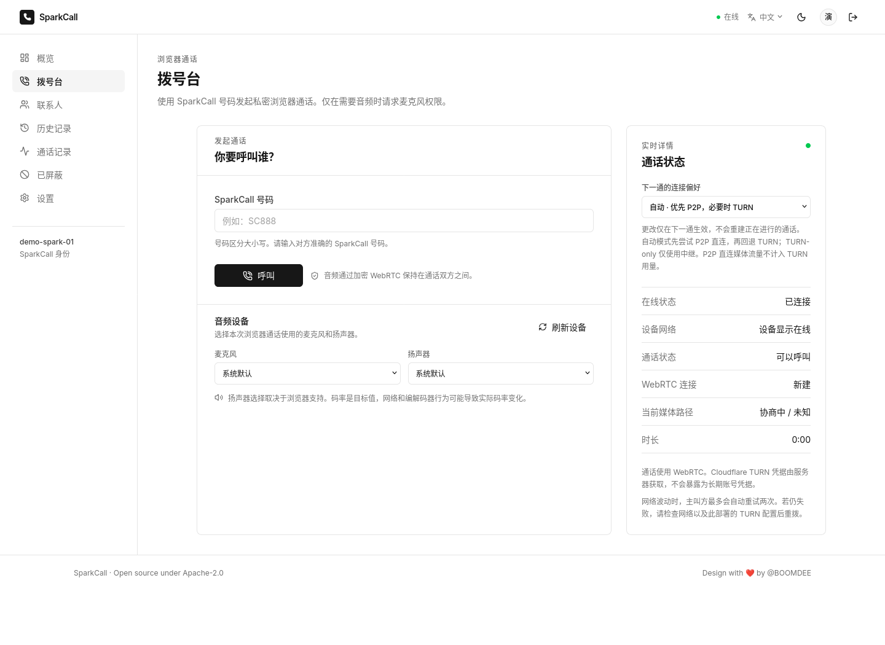
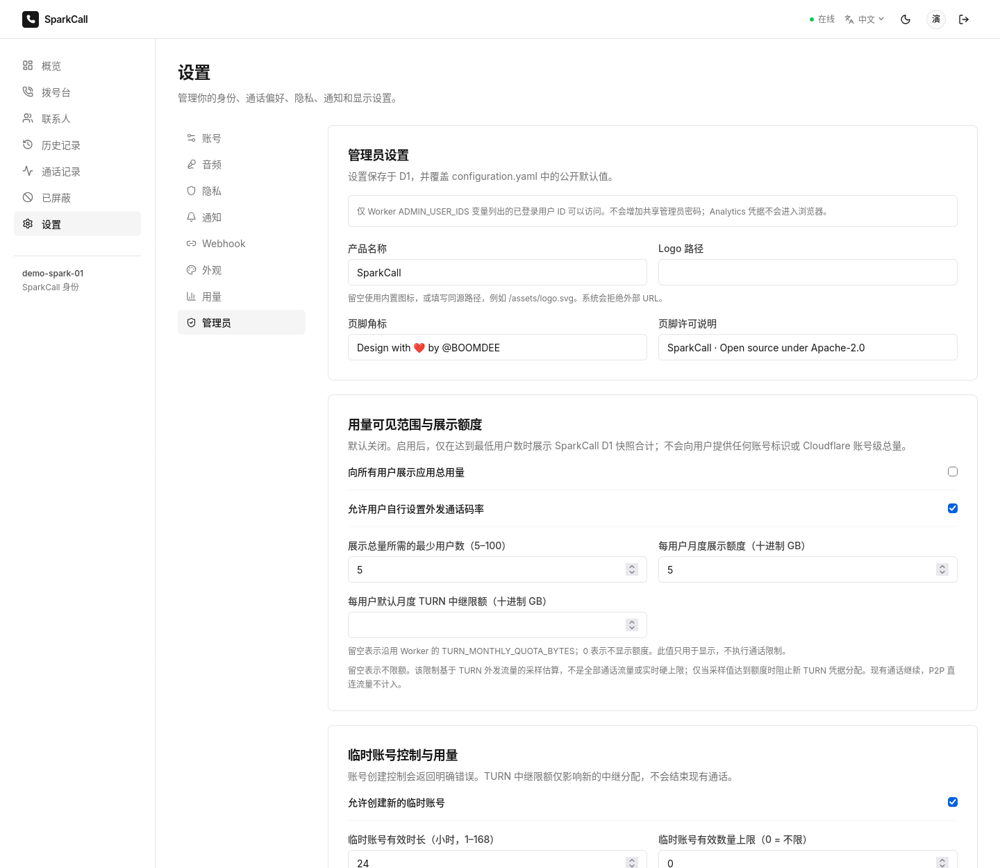
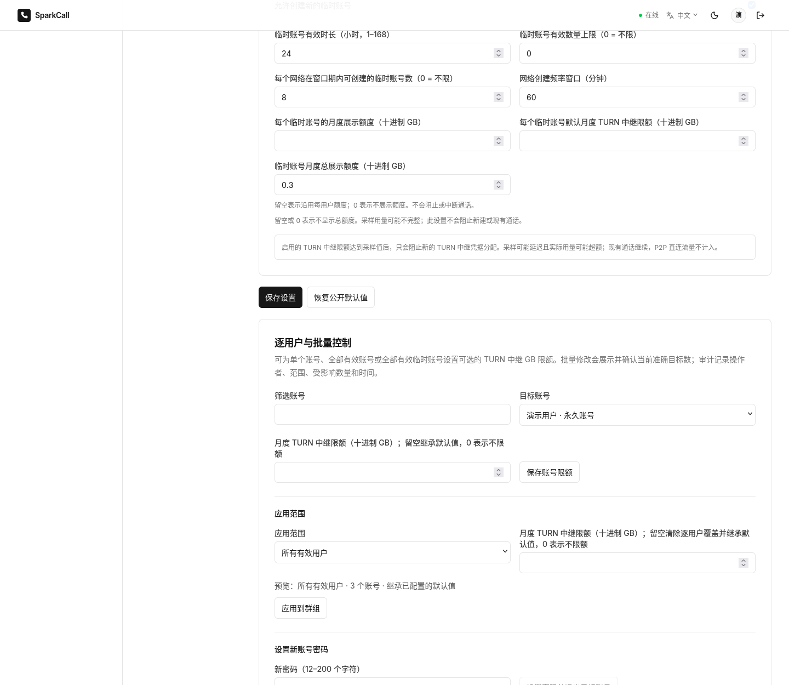

# SparkCall / 星火通话

[](https://github.com/BOOMDEE/SparkCall/actions/workflows/test.yml) [](https://github.com/BOOMDEE/SparkCall/releases) [](LICENSE) [](https://nodejs.org/) [](https://developers.cloudflare.com/workers/)

> **Version / 版本：** `0.1.0` (development source / 开发版本) · **No GitHub release has been published yet / 尚无 GitHub Release** — see [Releases](https://github.com/BOOMDEE/SparkCall/releases) for current status.
>
> SparkCall is an early-stage, self-hostable browser voice-calling application. The public site is a preview, not an SLA-backed production service: [call.boomdee.dpdns.org](https://call.boomdee.dpdns.org/).
>
> SparkCall 是一款早期、可自行部署的浏览器语音通话应用。当前公开站点仅供预览，不提供生产 SLA：[call.boomdee.dpdns.org](https://call.boomdee.dpdns.org/)。

The status badges above point to the repository's real GitHub Actions workflow, GitHub Releases, and checked-in license. No coverage, popularity, or other unsupported metrics are claimed.

以上徽章链接到仓库真实的 GitHub Actions、GitHub Releases 和项目许可证；不展示未经验证的覆盖率、受欢迎度或其他虚构指标。

## Screenshots / 界面预览

The following local browser captures use synthetic demo data and show the checked-in UI. They are not screenshots of production users or proof of production readiness.

以下截图来自本地应用，使用合成演示数据，展示当前仓库界面；不是生产用户截图，也不代表已达到生产就绪状态。








## What it does / 功能概览

- **Accounts and contacts:** username/password accounts, expiring temporary accounts, account upgrades, contacts, favorites, and block lists. Temporary accounts expire after 24 hours by default; the default active-account cap is unlimited, while account creation is rate-limited per IP.<br>
  **账号与联系人：** 用户名/密码账号、限时临时账号、账号升级、联系人、收藏和黑名单。临时账号默认 24 小时过期；默认不限制有效临时账号总数，但按 IP 限制创建频率。
- **Browser calls:** WebRTC audio, call invitations and lifecycle controls, microphone/device preferences, and a current-path indicator based on browser ICE statistics.<br>
  **浏览器通话：** WebRTC 音频、来电邀请与通话控制、麦克风/设备偏好；当前媒体路径根据浏览器 ICE 统计判定。
- **Connection preferences:** `Auto` prefers direct P2P and can fall back to TURN; `P2P-only` does not request TURN credentials; `TURN-only` requires a relay. A preference change affects the next call only.<br>
  **连接偏好：** `Auto` 优先 P2P 直连，必要时可回退到 TURN；`P2P-only` 不请求 TURN 凭据；`TURN-only` 必须通过中继。更改只对下一通生效。
- **Call records:** private by default; explicit public/revoked state, expiry, and public pages that omit internal identifiers and use `noindex, nofollow`. The app does not record call audio.<br>
  **通话记录：** 默认私有；需显式公开，可撤销和设定过期；公开页不返回内部标识并设置 `noindex, nofollow`。应用不录制通话音频。
- **Administration:** server-side allowlisted administrator access, site branding, usage privacy controls, temporary-account policy, per-account and bulk TURN limits, pseudonymous configuration export, password reset, and audit entries.<br>
  **管理员功能：** 服务端 allowlist 鉴权、全站品牌、用量隐私、临时账号策略、逐用户/批量 TURN 限额、假名化配置导出、密码重设及审计记录。

## Admin configuration and usage / 管理配置与用量

### Safe configuration split / 配置与密钥分离

The root [`configuration.yaml`](configuration.yaml) contains public, non-secret defaults. Administrators can save validated dynamic overrides in D1; the Worker combines those overrides with the defaults. **Never put a password, API token, account credential, or other secret in this YAML file.**

根目录 [`configuration.yaml`](configuration.yaml) 只存公开、非秘密默认值。管理员可将经过校验的动态覆盖保存到 D1，由 Worker 与默认值合并。**不要在 YAML 中放入密码、API token、账号凭据或其他秘密。**

A separate shared admin password is not used. Admins sign in with their normal SparkCall account, and the Worker authorizes immutable user IDs listed in the server-side `ADMIN_USER_IDS` variable. The browser cannot grant itself administrator access.

本项目不设置共享管理员密码。管理员使用自己的 SparkCall 账号登录，Worker 仅授权服务端 `ADMIN_USER_IDS` 变量列出的不可变用户 ID；浏览器端不能自行赋予管理员权限。

### Usage privacy and quota behavior / 用量隐私与限额行为

- Cloudflare account-level TURN totals are **admin-only**. `TURN_ANALYTICS_API_TOKEN` is a Worker Secret and is never returned to or bundled for the browser. Basic call setup does not need it, but admin usage analytics and sampled TURN limit checks do. Use an existing token with only read-only **Account Analytics** access for Realtime GraphQL; do not grant TURN key management or write permissions for analytics.<br>
  Cloudflare 账号级 TURN 总用量**仅管理员可见**。`TURN_ANALYTICS_API_TOKEN` 是 Worker Secret，不会返回或打包到浏览器。基本通话不依赖它，但管理员用量分析与采样 TURN 限额检查需要它。只使用已有且仅授予 Realtime GraphQL **Account Analytics 只读**权限的 token；不要授予 TURN key 管理或用量写权限。
- Public usage is disabled by default. If an administrator enables it, ordinary users can see only an app-level aggregate computed from SparkCall usage snapshots, and only after the configured anonymous-user threshold is met (default: 5). This is not a Cloudflare account total.<br>
  默认不公开用量。管理员启用后，普通用户只能看到由 SparkCall 用量快照聚合的应用级数据，且达到匿名人数门槛后才会显示（默认 5 人）；这不是 Cloudflare 账号总量。
- Each user sees their own usage. Admin platform totals and user-level records are protected by server-side authorization; individual account details are not exposed through the public aggregate.<br>
  普通用户只看到自己的用量。平台总量和逐用户数据受服务端权限保护；公开聚合不暴露单个账号明细。
- `monthlyUserQuotaBytes` and `monthlyTurnQuotaBytes` are **display quotas only**. The temporary-account `monthlyAggregateBudgetBytes` is a display-only group budget. They do not block calls. `TURN_MONTHLY_QUOTA_BYTES` is also a display fallback, not a hard cap.<br>
  `monthlyUserQuotaBytes` 与 `monthlyTurnQuotaBytes` **仅用于展示**；临时账号的 `monthlyAggregateBudgetBytes` 是仅展示的群组预算，不会阻止通话。`TURN_MONTHLY_QUOTA_BYTES` 也只是展示回退值，不是硬上限。
- `monthlyTurnLimitBytes` and per-user overrides are optional **monthly TURN-egress limits**. Blank/`null` inherits the configured default; `0` means unlimited. The default is `null` (no enforcement). Values entered in the admin UI are decimal GB and are stored as bytes.<br>
  `monthlyTurnLimitBytes` 和逐用户覆盖值是可选的**月度 TURN egress 限额**。留空/`null` 表示继承默认配置；`0` 表示不限额。默认值为 `null`（不执行限制）。管理员界面输入十进制 GB，存储为 bytes。
- The limit is based on Cloudflare TURN egress usage attributed to a user's custom identifier in sampled analytics and SparkCall snapshots. When the latest available monthly estimate reaches an enabled limit, only a **new TURN credential allocation** is refused with an explicit response. Existing calls continue. Auto mode can still try direct P2P; TURN-only mode cannot relay after the limit is reached. Since snapshots and provider analytics can lag, usage can overshoot; this is not a real-time total-call cap or billing guarantee.<br>
  限额依据 Cloudflare 采样分析中按用户 custom identifier 归因的 TURN egress，以及 SparkCall 快照。最新可用月度估算达到已启用限额后，只会明确拒绝**新的 TURN 凭据分配**，不会中断现有通话。Auto 模式仍可尝试 P2P 直连；达到限额后 TURN-only 无法通过中继。由于快照和服务商分析存在延迟，实际用量可能超额；这不是实时的全部通话硬上限，也不保证账单金额。

Cloudflare defines TURN usage in bytes and reports ingress/egress metrics; its TURN billing is based on egress to TURN clients. The Realtime free allowance is shared between TURN and SFU. See the official [TURN Analytics](https://developers.cloudflare.com/realtime/turn/analytics/), [TURN FAQ](https://developers.cloudflare.com/realtime/turn/faq/), and [Realtime pricing](https://developers.cloudflare.com/realtime/sfu/platform/pricing/). SparkCall's local-path label reads the selected ICE candidate pair through `RTCPeerConnection.getStats()`; see [MDN](https://developer.mozilla.org/en-US/docs/Web/API/RTCIceCandidatePairStats) and the [W3C WebRTC Stats specification](https://www.w3.org/TR/webrtc-stats/).

Cloudflare 以 bytes 提供 TURN ingress/egress 指标，TURN 费用按发往 TURN 客户端的 egress 计费；Realtime 免费额度由 TURN 与 SFU 共用。详见 Cloudflare 官方 [TURN Analytics](https://developers.cloudflare.com/realtime/turn/analytics/)、[TURN FAQ](https://developers.cloudflare.com/realtime/turn/faq/) 与 [Realtime 定价](https://developers.cloudflare.com/realtime/sfu/platform/pricing/)。SparkCall 的通话路径标签通过 `RTCPeerConnection.getStats()` 读取选中的 ICE 候选对；参见 [MDN](https://developer.mozilla.org/en-US/docs/Web/API/RTCIceCandidatePairStats) 和 [W3C WebRTC Stats 规范](https://www.w3.org/TR/webrtc-stats/)。

### User-management safeguards / 用户管理保护

The administrator UI can set a single user's TURN limit or apply one to all active users or all active temporary users. Bulk changes show the target count, require confirmation, re-check the count inside the D1 write batch, and record the operator, scope, affected count, and time. A changed target set is rejected and must be previewed again.

管理员可设置单个用户的 TURN 限额，也可应用到全部有效用户或全部有效临时用户。批量修改会显示目标数量并要求确认；D1 写入批次内会再次核验人数，并记录操作者、范围、受影响数量和时间。目标集合变化时会拒绝应用，要求重新预览。

Password reset accepts a new password and revokes the target account's sessions; it never reads or returns the old password. Configuration export is pseudonymous and limited to an allowlist of settings; it excludes names, usernames, numbers, password hashes, sessions, device IDs, API tokens, and secrets.

密码重设只接收新密码并撤销目标账号现有会话，不会读取或返回旧密码。配置导出使用假名化标识且仅导出白名单设置，不含姓名、用户名、号码、密码哈希、会话、设备 ID、API token 或 secret。

## Architecture / 架构

- `apps/web/`: React, TypeScript, Vite SPA; English and Simplified Chinese.<br>
  `apps/web/`：React、TypeScript、Vite 单页应用；支持英文和简体中文。
- `workers/api/`: Cloudflare Worker REST API, authentication, TURN analytics/credential issuance, and Durable Object classes.<br>
  `workers/api/`：Cloudflare Worker REST API、身份认证、TURN 分析/凭据签发和 Durable Object 类。
- D1 stores account, contact, call, record, preference, configuration, usage-snapshot, and admin-audit data.<br>
  D1 保存账号、联系人、通话、记录、偏好、管理员配置、用量快照和管理员审计数据。
- Durable Objects coordinate signaling and presence; WebRTC audio travels between browsers directly or through TURN. Durable Objects do not carry or store call audio.<br>
  Durable Objects 协调信令和在线状态；WebRTC 音频在浏览器间直传或经 TURN 中继。Durable Objects 不承载或存储通话音频。
- Worker Assets serve `apps/web/dist/`; the hourly scheduled handler performs cleanup and best-effort usage snapshots.<br>
  Worker Assets 提供 `apps/web/dist/`；每小时定时任务执行清理和尽力而为的用量快照。

See [docs/architecture.md](docs/architecture.md) for request boundaries and [docs/cloudflare-references.md](docs/cloudflare-references.md) for the checked official service/API references.

请求边界见 [docs/architecture.md](docs/architecture.md)；已核实的官方服务/API 参考见 [docs/cloudflare-references.md](docs/cloudflare-references.md)。

## Quick start / 快速开始

### Requirements / 环境要求

- Node.js 22+, npm, and Python 3 for integration tests.<br>
  Node.js 22+、npm；运行集成测试还需要 Python 3。
- A modern browser with microphone permission for manual call checks. Cloudflare credentials are not required for unit tests or isolated local D1 tests.<br>
  人工检查真实通话需要支持麦克风权限的现代浏览器。单元测试和隔离的本地 D1 测试不需要 Cloudflare 凭据。

### Local Wrangler / 本地 Wrangler

```bash
npm ci
cp .dev.vars.example .dev.vars
# Generate local-only values and put them in .dev.vars; never commit the file.
# 生成仅供本地使用的值并写入 .dev.vars；不要提交该文件。
openssl rand -hex 32      # INTERNAL_SIGNALING_TOKEN
openssl rand -base64 32   # SPARKCALL_WEBHOOK_ENCRYPTION_KEY
CI=1 npm run db:migrate:local
npm run build
npm run dev:worker
```

Open `http://localhost:8787`. For Vite hot reload, set `ALLOWED_ORIGIN=http://localhost:5173` in `.dev.vars` and run `npm run dev:web` in a second terminal.

打开 `http://localhost:8787`。如需 Vite 热更新，在 `.dev.vars` 中设置 `ALLOWED_ORIGIN=http://localhost:5173`，并在第二个终端运行 `npm run dev:web`。

`configuration.yaml` is public defaults, not a local secret file. `.dev.vars` and `.env` files are Git-ignored; `.env` is not used as the Worker secret store. In production, credentials belong in Cloudflare Worker Secrets and must never enter the repository, frontend bundle, static assets, or production package. Wrangler serves only the configured Worker modules and `apps/web/dist/`; it does not upload `.env` or `.dev.vars`.

`configuration.yaml` 是公开默认配置，不是本地密钥文件。`.dev.vars` 和 `.env` 文件已由 Git 忽略；`.env` 不作为 Worker secret 存储。生产凭据只能放在 Cloudflare Worker Secrets 中，绝不能进入仓库、前端 bundle、静态资源或生产包。Wrangler 只上传配置的 Worker 模块与 `apps/web/dist/`，不会上传 `.env` 或 `.dev.vars`。

## Configuration and secrets / 配置项与密钥

The tracked [`.dev.vars.example`](.dev.vars.example) contains blank placeholders, not live credentials. Local `.dev.vars` is for Wrangler development only.

仓库中的 [`.dev.vars.example`](.dev.vars.example) 只含空占位值，不包含真实凭据。本地 `.dev.vars` 仅供 Wrangler 开发使用。

| Variable / 变量 | Where / 存放位置 | Purpose / 用途 |
| --- | --- | --- |
| `INTERNAL_SIGNALING_TOKEN` | Worker Secret / Worker Secret | Worker-to-Durable-Object authentication. / Worker 与 Durable Object 间认证。 |
| `TURN_KEY_ID`, `TURN_API_TOKEN` | Worker Secrets / Worker Secrets | Server-side TURN key and short-lived credential issuance. / 服务端 TURN key 与短期凭据签发。 |
| `TURN_ANALYTICS_API_TOKEN` | Optional Worker Secret / 可选 Worker Secret | Account Analytics read-only token for Realtime TURN GraphQL usage. Never expose to the browser. / Realtime TURN GraphQL 用量查询的 Account Analytics 只读 token，绝不暴露给浏览器。 |
| `SPARKCALL_WEBHOOK_ENCRYPTION_KEY` | Worker Secret / Worker Secret | 32-byte AES-GCM key for encrypted webhook URL storage. / 加密存储 Webhook URL 的 32-byte AES-GCM 密钥。 |
| `ADMIN_USER_IDS` | Worker variable / Worker 变量 | Comma-separated SparkCall user IDs allowed to administer the site; not a shared password. / 获准管理站点的逗号分隔 SparkCall 用户 ID；不是共享密码。 |
| `CLOUDFLARE_ACCOUNT_ID` | Worker variable / Worker 变量 | Selects the Cloudflare account for Analytics queries. / 指定 Analytics 查询所用 Cloudflare 账号。 |
| `TURN_MONTHLY_QUOTA_BYTES` | Optional display variable / 可选展示变量 | Display fallback only; no call enforcement. / 仅作为展示回退值，不执行通话限制。 |
| `ALLOWED_ORIGIN` | Worker variable / Worker 变量 | Expected browser origin and CSRF boundary. / 预期浏览器 Origin 与 CSRF 边界。 |
| `SESSION_TTL_SECONDS`, `TEMP_SESSION_TTL_SECONDS` | Worker variables / Worker 变量 | Session lifetime settings. / 会话有效期设置。 |
| `TURN_CREDENTIAL_TTL_SECONDS` | Worker variable / Worker 变量 | Requested lifetime of TURN credentials. / TURN 凭据请求有效期。 |

The optional analytics token and the TURN credential key are separate credentials. If Analytics is not configured, TURN calls can still work; platform usage shows as unavailable and quota enforcement fails open when no usable snapshot is available.

可选的 Analytics token 与 TURN 凭据 key 是两种不同凭据。未配置 Analytics 时，TURN 通话仍可工作；平台用量显示不可用，并且没有可用快照时配额检查 fail-open，不会默默阻断通话。

## Database migrations / 数据库迁移

D1 migrations are sequential and applied incrementally:

D1 迁移按顺序增量应用：

| Migration / 迁移 | Adds / 变更 |
| --- | --- |
| `0001_initial.sql` | Core user, session, contact, block, call, record, and usage tables. / 用户、会话、联系人、黑名单、通话、记录和用量基础表。 |
| `0002_security_and_preferences.sql` | Security metadata, record capabilities, preferences, login counters, and reserved numbers. / 安全元数据、记录 capability、偏好、登录计数和保留号码。 |
| `0003_preserve_record_capabilities.sql` | Retains eligible record capabilities after temporary-user cleanup. / 临时账号清理后保留符合条件的记录 capability。 |
| `0004_incoming_call_webhooks.sql` | Encrypted incoming-call webhook settings. / 加密的来电 Webhook 设置。 |
| `0005_version_user_preferences.sql` | Versioned preference updates. / 带版本的偏好更新。 |
| `0006_admin_configuration.sql` | Validated non-secret dynamic configuration overrides. / 经过校验的非秘密动态配置覆盖。 |
| `0007_admin_user_controls.sql` | Per-user TURN limits and admin audit records. / 逐用户 TURN 限额与管理员审计记录。 |

```bash
CI=1 npm run db:migrate:local
# Remote migration is part of the separately authorized manual release flow.
# 远程迁移只通过另行授权的手动发布流程执行。
```

Do not edit an applied migration. Add a new numbered SQL migration, review compatibility, and back up the target D1 database before a release.

不要修改已应用的迁移。请新增编号 SQL 迁移、审查兼容性，并在发布前备份目标 D1 数据库。

## Quality checks / 质量检查

```bash
npm ci
npm run check
npm run lint
npm test
npm run build
npm run quality
npm run test:integration
```

`npm run quality` runs TypeScript checks, ESLint, Vitest, and the frontend production build. `npm run test:integration` uses temporary loopback Wrangler and isolated local D1; it does not log in, deploy, or apply remote migrations.

`npm run quality` 执行 TypeScript 检查、ESLint、Vitest 和前端生产构建。`npm run test:integration` 使用临时回环 Wrangler 与隔离本地 D1；不会登录、部署或应用远程迁移。

These checks do not prove real microphone access, cross-NAT audio, every browser/device combination, remote TURN billing accuracy, or production readiness. See [docs/testing.md](docs/testing.md) for coverage and manual verification gaps.

这些检查不能证明真实麦克风、跨 NAT 音频、所有浏览器/设备兼容、远程 TURN 账单准确性或生产可用性。覆盖范围和人工验证缺口见 [docs/testing.md](docs/testing.md)。

## CI and deployment / CI 与部署

- The **Test** workflow runs quality and isolated integration checks on pushes to `Main`, pull requests to `Main`, and manual dispatch.<br>
  **Test** workflow 在推送到 `Main`、针对 `Main` 的 PR 和手动触发时运行质量与隔离集成检查。
- The deployment workflow is `workflow_dispatch` only. It has no push trigger, and automatic production deployment remains disabled.<br>
  部署 workflow 仅支持 `workflow_dispatch` 手动触发；没有 push trigger，生产自动部署保持关闭。
- Deployment runs quality/integration gates, checks required Worker Secret *names* without reading their values (including `TURN_ANALYTICS_API_TOKEN`), validates the target account and `ADMIN_USER_IDS`, applies remote migrations, then deploys the Worker and static assets. Analytics is not needed for call setup, but is required for admin usage analytics and sampled TURN limit checks.<br>
  部署会先通过质量/集成门禁，只检查必需 Worker Secret 的**名称**而不读取值（包括 `TURN_ANALYTICS_API_TOKEN`），校验目标账号与 `ADMIN_USER_IDS`，再应用远程迁移并部署 Worker 与静态资源。Analytics 不影响基本通话，但管理员用量分析和采样 TURN 限额检查需要配置它。
- The workflow is an update path, not first-install bootstrap. See [`docs/deployment.md`](docs/deployment.md) and review target account/database/hostname before each manual release.<br>
  工作流用于更新，不负责首次 bootstrap。每次手动发布前请阅读 [`docs/deployment.md`](docs/deployment.md)，复核目标账号、数据库和域名。

## Known limitations / 已知限制

SparkCall is an early pre-release with no production SLA or security certification. Real two-device audio, cross-NAT networking, accessibility, mobile browser behavior, and speaker routing still need manual acceptance. TURN analytics snapshots are estimates, not billing statements. The optional webhook is best-effort and has a documented DNS resolution-to-connect limitation. R2 uploads, payment/3DS, and call recording are not implemented.

SparkCall 仍处于早期预发布阶段，没有生产 SLA 或安全认证。双设备真实音频、跨 NAT 网络、无障碍、移动浏览器和扬声器路由仍需人工验收。TURN 分析快照是估算值，不是账单。可选 Webhook 仅尽力发送，并存在已说明的 DNS 解析到连接限制。R2 上传、支付/3DS 和通话录音尚未实现。

## Contributing and security / 贡献与安全

Read [CONTRIBUTING.md](CONTRIBUTING.md), [CODE_OF_CONDUCT.md](CODE_OF_CONDUCT.md), [SECURITY.md](SECURITY.md), and [AGENTS.md](AGENTS.md) before contributing. Do not commit credentials, `.env`, `.dev.vars`, personal records, or generated production artifacts. Use English Conventional Commit subjects and run the relevant checks.

贡献前请阅读 [CONTRIBUTING.md](CONTRIBUTING.md)、[CODE_OF_CONDUCT.md](CODE_OF_CONDUCT.md)、[SECURITY.md](SECURITY.md) 和 [AGENTS.md](AGENTS.md)。不要提交凭据、`.env`、`.dev.vars`、个人记录或生产构建产物。Commit subject 使用英文 Conventional Commit，并运行相应检查。

Do not report security issues, credentials, call metadata, or personal data in public issues. Follow the private reporting instructions in [SECURITY.md](SECURITY.md).

请勿在公开 issue 中披露安全问题、凭据、通话元数据或个人数据；私下报告渠道见 [SECURITY.md](SECURITY.md)。

## License / 许可证

SparkCall is distributed under the [Apache License 2.0](LICENSE). / SparkCall 按 [Apache License 2.0](LICENSE) 发布。

**Author / 作者:** 尹嘉骐 · **GitHub:** [BOOMDEE](https://github.com/BOOMDEE)
