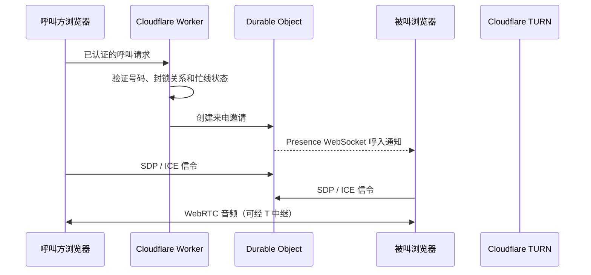

# SparkCall 架构与安全边界

## 请求与媒体路径

浏览器通过同源 REST API 登录、管理账户和提交呼叫请求；Worker 校验会话、号码、黑名单及通话参与者后才访问 Durable Objects。信令 WebSocket 承载 SDP、ICE candidate 和通话状态，Durable Objects 使用 hibernation 与持久化邀请以支持在线状态和短时重连。WebRTC 媒体直接走 peer-to-peer；网络受限时使用 Cloudflare Realtime TURN。音频不会经过 Durable Objects，也不会由应用录制。

## 身份与会话

- 永久账号使用用户名和密码；密码仅以版本化 PBKDF2-SHA-256 哈希存储，使用 HttpOnly、Secure、SameSite cookie 维护会话。
- 临时身份使用随机内部 ID 与随机 SparkCall 号码，默认 24 小时过期。过期清理由 Worker cron 执行。
- 升级操作在事务中把同一用户记录转换为永久账号，因而保留符合条件的联系人和通话记录。
- 号码以 SQLite BINARY collation 区分大小写；用户 ID 与公开号码是独立字段。
- API 校验请求 Origin、强制输入长度/格式限制，并使用参数化 SQL。登录尝试在 D1 中原子计数；KV 非必需，避免缓存不可用时降低限流保护。

## 数据和权限

| 数据 | 存放位置 | 访问边界 |
| --- | --- | --- |
| 用户、会话、号码、联系人、黑名单、通话元数据、偏好 | Cloudflare D1 | 仅通过 Worker 校验会话后读写 |
| 呼叫信令、在线呼入邀请、短时重连状态 | SQLite-backed Durable Objects | Worker 使用内部随机 secret 调用；WebSocket 连接前核验参与者身份 |
| Web 静态资源 | Cloudflare Worker Assets | 公开网页；不含任何 server secret |
| WebRTC 中继媒体 | Cloudflare Realtime TURN | 浏览器只拿到绑定用户 ID 的短期 ICE credentials |

公共通话记录默认私有。公开由所有者显式开启，可撤销、设定过期时间并更改 slug。公开内容不包含邮箱、内部 ID、会话或凭据；参与者姓名仅在参与者明确授权后展示。公开记录页面设置 `noindex, nofollow`。临时用户通过记录专用的 HttpOnly capability cookie 保留后续管理/撤销能力；该能力不使用可预测记录 ID。

## TURN 用量

Worker 使用 Cloudflare Realtime 官方 GraphQL Analytics 查询 `egressBytes`，并以 `customIdentifier` 区分用户。定时任务每小时轮转最多 25 个活动用户并将估算快照写入 D1。采样数据可能延迟或不完整，因此接口标记 `authoritative: false`。`TURN_MONTHLY_QUOTA_BYTES` 是展示配额，不是实时的流量闸门。分析 API token 仅存在于 Worker secret，不会返回浏览器。

## 计划取舍与限制

- Workers Web Crypto 不提供原生 Argon2id 派生函数；本实现使用 310,000 轮 PBKDF2-SHA-256，并保存版本标记，便于以后更换哈希方案。
- D1 原子计数是强制登录限流；KV 绑定未启用，因为当前没有非关键缓存需要它。
- R2 用于头像或用户上传是可选能力，当前未启用。
- 自动化检查包含类型检查、lint、前端/API 客户端单元测试、生产构建和本地 SQL migration 应用；真实浏览器跨 NAT 通话、不同浏览器扬声器切换和完整 3DS/支付流程不属于本项目，必须由部署后的真实环境测试。
